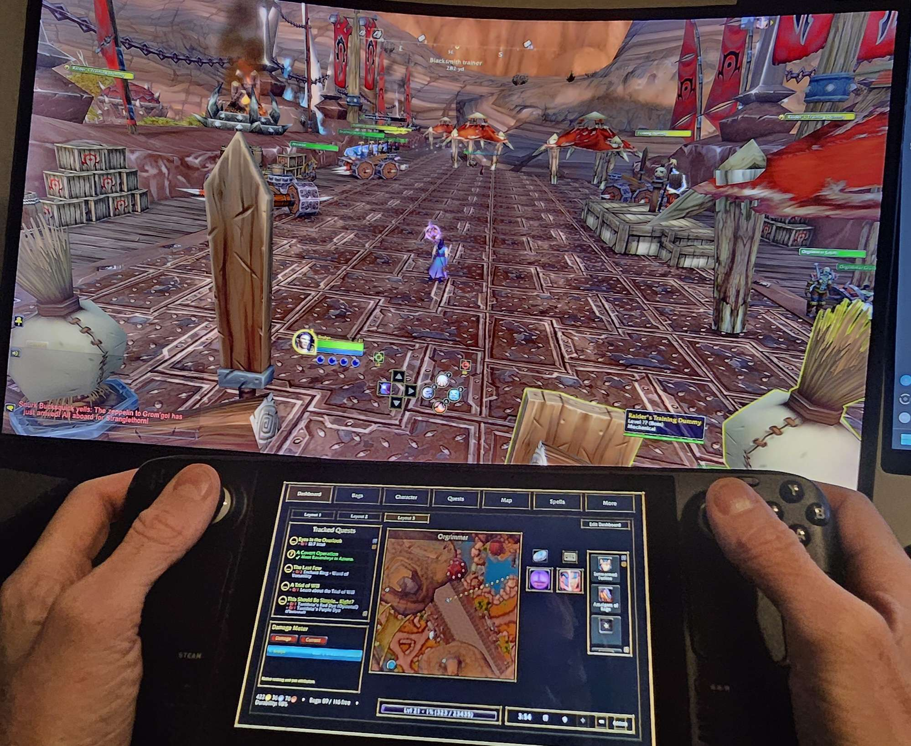
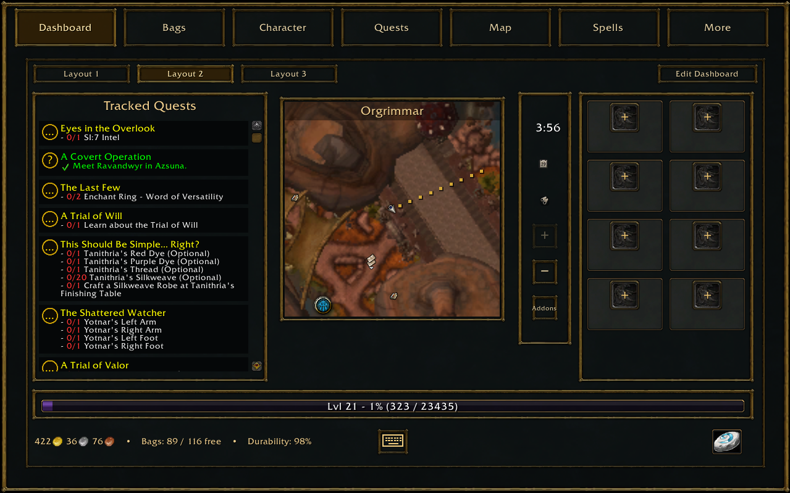
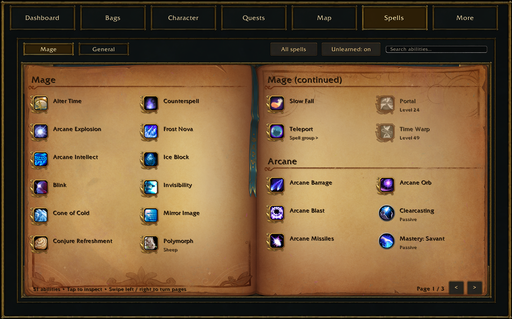
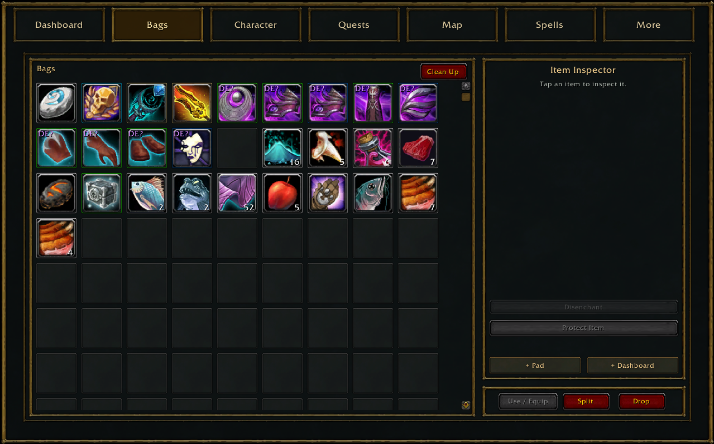
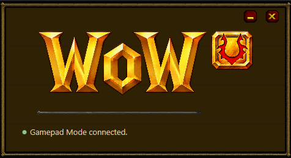
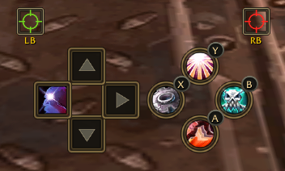
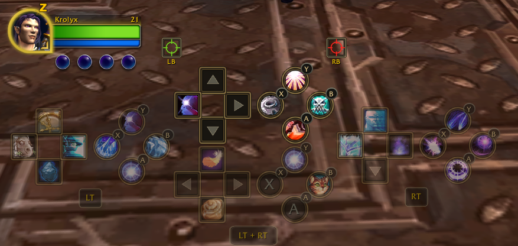

  

<h1 align="center">Your adventure. A second screen.</h1>

  A touchscreen companion for World of Warcraft, with a Windows Assistant that handles the setup behind the scenes.

  
  
  

  <a href="#what-is-wowu">Overview</a> &nbsp;·&nbsp;
  <a href="#downloads">Downloads</a> &nbsp;·&nbsp;
  <a href="docs/GETTING-STARTED.md">Getting started</a> &nbsp;·&nbsp;
  <a href="docs/FEATURES.md">Features & compatibility</a> &nbsp;·&nbsp;
  <a href="docs/SCREENSHOTS.md">Screenshots</a>

---

## What is WoWU?

WoWU brings your bags, quests, maps, spells and other everyday Warcraft controls onto a separate touchscreen. Keep the world on your main display and use a handheld, tablet or other Moonlight-capable device as your companion interface.

The **WoWU addon** provides the interface inside the game. The **Gamepad Assistant** prepares the Windows display and manages Sunshine streaming. **Moonlight** puts that companion display on your device.

  
   <em>Main-screen gameplay. Your companion interface in your hands.</em>

[See the screenshot gallery →](docs/SCREENSHOTS.md)

## Made for your next adventure

| | What you can do |
|---|---|
| **A dashboard that fits you** | Arrange the minimap, tracked quests, Quick Access buttons, notifications and other widgets. Save different layouts. |
| **Everyday actions, within reach** | Browse bags, read quests, turn spellbook pages and interact with supported NPC services through touch-friendly screens. |
| **Controller play** | Assign supported spells and items to trigger layers, move and scale button clusters, and use the optional compact HUD. |
| **Find your way** | Use the compass, destination guidance, quest trails and version-specific services, rares and notable-location data. |
| **A quiet desktop companion** | Start the Assistant, enable Gamepad Mode in WoW and connect through Moonlight. Display preparation and streaming run in the background. |
| **Return to normal play** | Disabling Gamepad Mode restores the gameplay layout and minimap. WoWU starts hidden when the mode is off. |

Feature availability follows the running WoW client. Forever retains its native controller system; some Classic screens use hosted Blizzard windows. [Read the complete support matrix →](docs/FEATURES.md)

## A look inside

<table>
  <tr>
    <td width="50%" align="center"> <strong>Your dashboard</strong> Quests, maps and shortcuts in one touch-friendly layout.</td>
    <td width="50%" align="center"> <strong>A familiar spellbook</strong> Browse abilities and swipe through the pages.</td>
  </tr>
  <tr>
    <td width="50%" align="center"> <strong>Bags within reach</strong> A clear inventory grid and a dedicated item inspector.</td>
    <td width="50%" align="center"> <strong>A quiet Assistant</strong> Just the logo and the connection status.</td>
  </tr>
</table>

### Choose your controller layout

<table>
  <tr>
    <td width="50%" align="center"> <strong>Compact</strong> One eight-button pair changes with your triggers.</td>
    <td width="50%" align="center"> <strong>Expanded</strong> Keep the separate trigger-layer clusters visible.</td>
  </tr>
</table>

These are unedited development captures. Feature availability varies by client; Forever retains its own native controller system. Click any image to view the original.

## Downloads

  

Download the addon from Curseforge, or use the Curseforge app

## The everyday flow

1. **Start the Assistant.** It prepares the owned virtual display and managed streaming host.
2. **Launch WoW normally.** Enter the world with the matching WoWU addon enabled.
3. **Enable Gamepad Mode.** WoWU and the Assistant coordinate the viewport and companion interface.
4. <a href="https://moonlight-stream.org/">**Connect with Moonlight.**</a> Choose **WoWU Gamepad** and use **1280 × 800**, and **Optimize mouse for remote desktop instead of games** First-time pairing opens a PIN window in the Assistant.

The companion stream is configured without audio, leaving your normal game sound on the PC. Initial driver setup may ask for Windows administrator approval or a restart.

[Setup, requirements and troubleshooting →](docs/GETTING-STARTED.md)

## Which Warcraft clients?

| Client | Current development focus |
|---|---|
| **Retail** | Broad custom-module support, modern talents and professions, custom banking and controller features. |
| **WoW Forever** | Companion interface, viewport and Forever-specific systems; uses Forever's own native gamepad controls. |
| **Classic Era** | Dedicated quest, map, navigation and layout work, with native fallbacks for some modules. |
| **Mists Classic** | Dedicated talent tiers, professions, quest-map integration, Dungeon Journal, Dungeon Finder and PvP views. |
| **Other Classic branches** | Selected adapters and native fallbacks exist. They have not received a complete live acceptance pass. |

The [80-feature matrix](docs/FEATURES.md) distinguishes custom interfaces, native fallbacks, conditional support and features that are not provided. Support is not identical across clients.

## Development status

WoWU is a **private development preview**.

## Feedback from testing

Found a problem? Include your **WoW client and build**, **addon/Assistant versions**, what you were doing, and any exact error text. A clean screenshot of the affected screen is especially helpful. Please omit account details, chat conversations and pairing PINs.

[Open an issue](../../issues/new/choose)

## Project and artwork

WoWU is a community project and is not affiliated with or endorsed by Blizzard Entertainment. Warcraft names and game artwork belong to their respective owners. Existing third-party notices and source records remain applicable; this documentation refresh does not introduce a new software licence.

Moonlight and Sunshine are separate projects. Sunshine is managed as a separate process by the current Assistant. The repository's original [development brief](DEVELOPMENT-BRIEF.md) and [milestone notes](MILESTONE-1.md) are historical design references.

