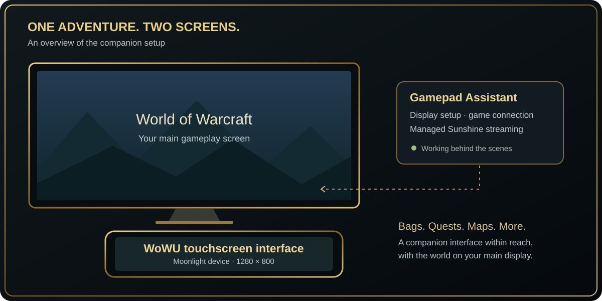

# WoWU in action

Actual development captures supplied by the project owner. Images are published unchanged; click them to open the original. These screens illustrate the supplied development session, not identical support across every Warcraft client. See the [feature matrix](FEATURES.md) for client-specific coverage.

[Back to the project overview](../README.md)

## The whole setup

Main-screen gameplay with WoWU running on a handheld touchscreen.

## Dashboard

A dashboard layout with tracked quests, minimap, map controls, Quick Access and experience bar.

## Bags

The inventory grid with a separate item-inspector panel and touch-sized action buttons.

## Spellbook

The parchment spellbook with Mage abilities, active/passive spells and page controls.

## Compact controller layout

Compact controller layout: one D-pad and face-button pair, plus LB and RB.

## Expanded controller layout

Expanded controller layout showing the no-trigger, LT, RT and LT+RT clusters.

## Windows Assistant

The minimal Windows Assistant showing Gamepad Mode connected.

## How it fits together

The Windows Assistant prepares the display and streaming host. WoWU provides the companion interface inside the game, and Moonlight displays it on the handheld or tablet.

